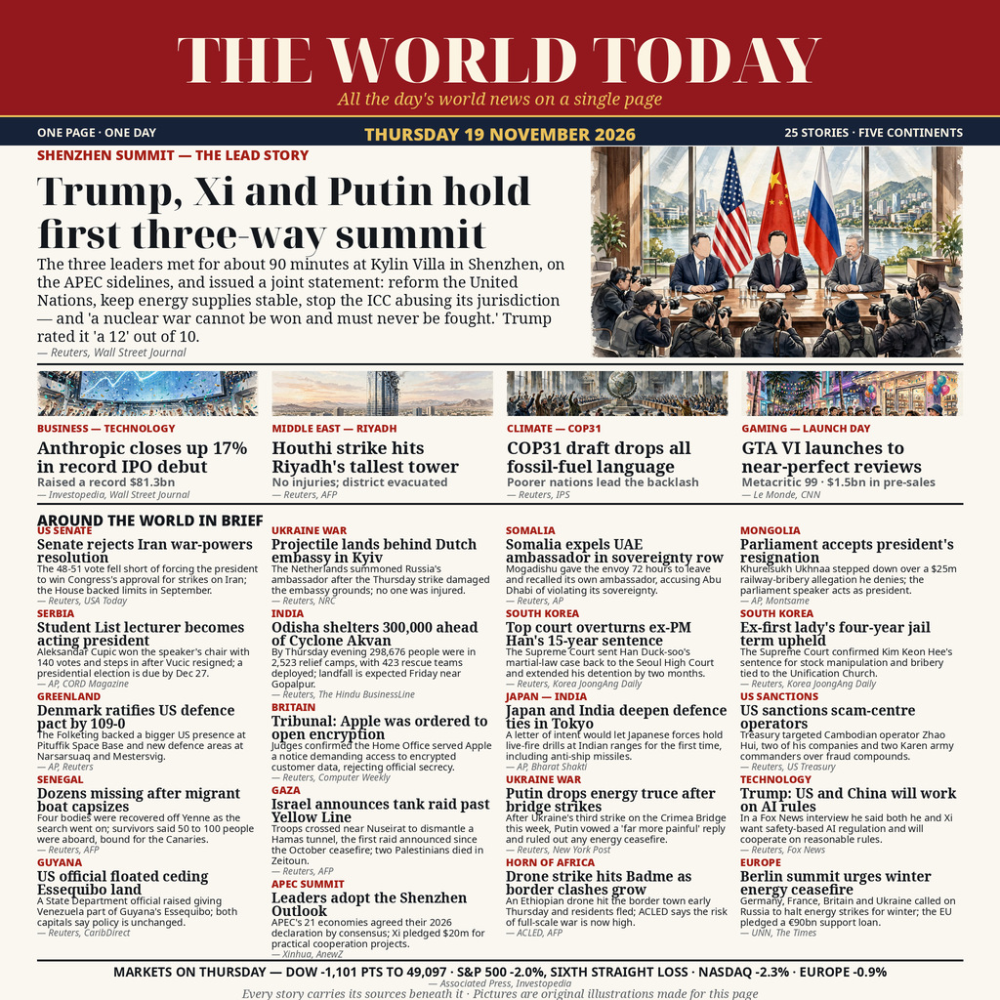

# THE WORLD TODAY — Thursday 19 November 2026

Entry for the make.fun bounty **news-image-20261119** ("Sum up 19 November's
world news in one image") — bounty page: https://make.fun/bounty/news-image-20261119.

One front page, 25 stories: the first-ever three-way summit of the US,
Chinese and Russian presidents in Shenzhen as the lead, Anthropic's
record-breaking IPO debut on the Nasdaq, the Houthi strike on Riyadh's
PIF Tower, the COP31 draft that dropped every fossil-fuel reference,
and GTA VI's launch day — and twenty world briefs, among them Putin
ruling out an energy truce after Ukraine's third Crimea Bridge strike
of the week, South Korea's Supreme Court overturning ex-PM Han
Duck-soo's 15-year sentence, Odisha sheltering almost 300,000 people
ahead of Cyclone Akvan, Denmark ratifying the Greenland defence pact
109-0, and Somalia expelling the UAE ambassador — plus the day's
market moves in the footer.

## How it was made

- Every story was reported on Thursday 19 November 2026 and is confirmed by
  at least two independent credible outlets (Reuters, AP, AFP, the Wall
  Street Journal and peers). The full sourcing, with the exact facts and
  figures used on the page — and the list of stories deliberately dropped
  for failing that two-source test or belonging to another day — is in
  [SOURCES.md](SOURCES.md).
- The five pictures are original illustrations generated for this page and
  contain no text. All headlines, labels and the masthead were typeset
  programmatically (PIL) at 2048×2048 and downscaled with a Lanczos resample
  to the final 1024×1024, saved as JPEG quality 93 with 4:4:4 chroma, then
  proofread letter by letter at full zoom.
- The third design is a hybrid: the first design's page kept exactly,
  with colour at the top only — a deep-crimson nameplate band with the
  title reversed out in cream and a gold italic tagline, over a navy date
  strip with the date in gold. Everything below the date strip is the
  first design pixel for pixel. Same stories, same texts.
- `main.py` (Python 3, standard library only) verifies the committed
  image's size and sha256, then copies it to `$MAKEFUN_OUTPUT_DIR/entry.png`
  (or `/output/entry.png`). It is deterministic: repeated runs produce
  byte-identical output.

## Files

- `entry.png` — the finished image (JPEG-encoded, 1024×1024, 569,611 bytes,
  under the 1 MiB limit; the rules accept PNG or JPEG by magic bytes).
- `main.py` — the entry program.
- `SOURCES.md` — story-by-story sourcing and fact sheet.
